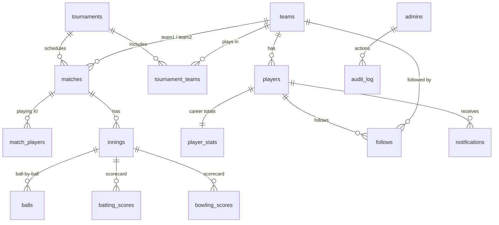

# CricLive – Technical documentation

## 1. Architecture

```
Browser (HTML/CSS/JS, SVG charts)          Node.js server (no external packages)
 ├─ public pages  ── fetch JSON ──────────▶ src/http.js     router, sessions, security headers, CSRF check
 ├─ admin/scorer console                    src/routes.js   REST API + role-based access control
 └─ EventSource /api/live ◀── push ──────── src/live.js     Server-Sent Events: score, stats, alerts
                                            src/engine.js   cricket rules (balls → innings → result → stats)
                                            src/state.js    scoreboard / scorecard / standings read models
                                            src/analytics.js charts data + K-Means player segmentation
                                            src/notify.js   match alerts & notifications
                                            src/db.js       SQLite (built into Node 22) or MySQL (mysql2)
```

* **Real-time:** every open page keeps one Server-Sent Events connection. After every scoring action, the server pushes the new scoreboard to viewers of that match, a summary card to every page, the IDs of players whose stats changed, and any alerts.
* **Single source of truth:** the `balls` table. After each ball (or undo), the innings, batting card, bowling card and the career `player_stats` of the players involved are recalculated inside one transaction. Transactions are queued, so two scorers cannot corrupt a score.

## 2. Database (16 tables)



Also: `admins` (with `role` admin/scorer) and `sessions`. The full definitions are in `database/schema.sqlite.sql` and `database/schema.mysql.sql`.

## 3. Roles and access control

| Action | Viewer | Player | Scorer | Admin |
|---|:-:|:-:|:-:|:-:|
| Watch live scores, scorecards, stats, charts, AI analytics | ✓ | ✓ | ✓ | ✓ |
| Follow teams/matches, pop-up alerts on this device | ✓ | ✓ | ✓ | ✓ |
| Register, edit own profile, notifications inbox | | ✓ | | |
| Score matches (toss, XI, balls, undo, end innings) | | | ✓ | ✓ |
| Manage teams, players, tournaments, fixtures; abandon/reschedule | | | | ✓ |
| Manage staff accounts, view audit log | | | | ✓ |

Every rule is enforced **on the server** (`requireStaff`, `requireAdmin`, `requirePlayer` in `src/routes.js`). Hiding buttons in the browser is only for convenience.

## 4. Security measures

| Threat | Measure |
|---|---|
| Stolen passwords | scrypt hash with random salt; plain passwords never stored; policy of 8+ characters with a letter and a number |
| Brute force | 5 failed logins → 5-minute lockout per account and IP (HTTP 429) |
| Session hijacking | random 192-bit session ID; cookie HttpOnly + SameSite=Lax; new session on every login; 7-day expiry; deleting a staff account ends their sessions |
| CSRF | POST/PUT/DELETE rejected if the Origin/Referer is another site (HTTP 403) |
| XSS | all output escaped (`esc()`, `textContent`); Content-Security-Policy `default-src 'self'` |
| SQL injection | only parameterised queries (`?` placeholders) |
| Clickjacking / sniffing | `X-Frame-Options: SAMEORIGIN`, `X-Content-Type-Options: nosniff`, `Referrer-Policy` |
| Bad input | server-side validation of every field (lengths, numbers, dates, emails, roles, cricket rules) |
| Accountability | `audit_log` table records each staff login and change with user, role, time and IP |

## 5. Match alerts and notifications

`notify.deriveAlerts(before, after)` compares the match before and after each scoring action and produces alerts for: match started, wicket, fifty or hundred, 3- or 5-wicket haul, innings break, result, abandoned, new fixture and rescheduled fixture.

* **Live pop-ups:** sent to every open page. The page shows them if the viewer follows the match or either team (follows are kept in the browser, and also on the server for logged-in players). If browser notifications are allowed, they appear even when the tab is in the background.
* **Inbox:** important alerts are saved in `notifications` for players who follow the teams (and for the player who reached a milestone). The bell icon shows the unread count, and the inbox also lists upcoming fixtures of followed teams.

## 6. AI player segmentation (K-Means)

This uses the same method as customer RFM segmentation, with cricket features:

1. **Features** per player (2+ innings or 2+ overs bowled): runs per match, strike rate, boundary %, wickets per match, balls bowled per match.
2. **Shrinkage:** strike rate and boundary % are blended with a neutral prior worth 15 balls, so tiny samples don't dominate.
3. **`log1p` transform**, then **standard scaling** (z-scores).
4. **Elbow method:** K-Means is run for k = 2…8 and the inertia is plotted.
5. **Final model:** k = 4, k-means++ initialisation, best of 10 seeded runs (deterministic).
6. **Profiling:** cluster centroids are scored against cricket archetypes (Power Hitters, Anchor Batters, Strike Bowlers, All-round Contributors, Developing Players) and given recommendations.

The **AI suggested XI** on team pages picks a wicket-keeper, the 5 best bowlers (wickets per match and economy), then the best batters (average and strike rate).

## 7. Test plan and results (`npm test`)

| # | Test | Expected | Result |
|---|---|---|---|
| 1 | Wide, no-ball, leg-bye, runs; end of over | totals and extras correct; leg-byes not charged to bowler; wide not a ball faced; strike changes after 6 legal balls; same bowler blocked | Pass |
| 2 | Wickets, all out, target, chase, undo | caught requires fielder; innings 2 target = runs + 1; "won by 2 wickets"; undo re-opens match | Pass |
| 3 | Career stats | `player_stats` equals the sum of scorecards | Pass |
| 4 | Points table | win = 2, abandoned = 1 each, NRR = +6.000 for the test match | Pass |
| 5 | K-Means | same seed → same clusters; separates two clear groups | Pass |
| 6 | Security and RBAC | headers present; anonymous 401; scorer 403 on team create; admin allowed; cross-site 403; action audited; 6th login after 5 failures → 429; weak password rejected; password stored as scrypt hash | Pass |

### Manual tests carried out in the browser
* The viewer's scoreboard updates without a refresh when the scorer records a ball.
* Player profile stats and charts update live after each ball they are involved in.
* A follower of the batting team on the home page receives a "WICKET!" pop-up instantly.
* The scorer account sees only the Matches tab; a direct API call to create a team returns 403.
* All pages load with no JavaScript errors in light mode, dark mode and on a 390 px phone screen.


## Version 4 additions

### Sign-in with a one-time code (`src/otp.js`, `src/mailer.js`)
Sign-in and sign-up are two steps. Step 1 checks the password (or, for sign-up, every field). It creates a row in `otp_codes` and e-mails a 6-digit code made by `crypto.randomInt`. Only `SHA-256(challenge id : code : SESSION_SECRET)` is stored. Step 2 (`POST /api/auth/otp/verify`) compares the hashes in constant time, marks the row used (`UPDATE ... WHERE used = 0`, so a race cannot use it twice), and only then starts a session. Limits:

- each code expires after 5 minutes and allows 5 tries;
- a new code needs a 30-second wait, with at most 3 resends;
- each e-mail gets at most 5 codes per 15 minutes;
- each network gets 20 wrong codes before a 5-minute pause.

For sign-up, the account is created only after the code is verified; the pending details (with the password already hashed) wait in `otp_codes.payload`.

`mailer.js` is a dependency-free SMTP client: implicit TLS on port 465, STARTTLS on 587, AUTH PLAIN or LOGIN, and a multipart text and HTML message. With no `SMTP_HOST` it runs in development mode: the code is printed in the terminal and returned to the browser (`dev_code`), so the system can be demonstrated without an e-mail account.

### Passwords and e-mail (`src/util.js`)
`passwordProblems()` returns the rules a password breaks:

- 10 or more characters, with lowercase, uppercase, a number and a symbol;
- not a common password;
- no runs like 1234, abcd or aaaa;
- not the user's name, username or e-mail.

The browser shows the same rules live (`public/js/auth.js`). Hashes are `scrypt2$32768$salt$hash`. Older `scrypt$` hashes still verify. An unknown account still runs one hash, so timing does not reveal which accounts exist.

`checkEmailFormat()` checks syntax, typos close to popular domains (edit distance 2 or less), and throw-away domains. `checkEmailDomain()` asks DNS for MX records, with a 3-second limit. A network error skips the check rather than blocking sign-up.

### Downloads (`src/reports.js`)
| Endpoint | File |
|---|---|
| `GET /api/matches/:id/download/report.html` | Stand-alone HTML report: SVG charts, key numbers, tips, scorecards |
| `GET /api/matches/:id/download/balls.csv` | Every ball with the running score |
| `GET /api/matches/:id/download/scorecard.csv` | Batting and bowling cards |
| `GET /api/players/:id/download/report.html` | Player report: 9 charts and an improvement plan |
| `GET /api/players/:id/download/matches.csv` | One row per match |

The tips come from rules applied to the ball data: phase run rates, dot-ball %, extras, conversion of starts, the most common dismissal, wides per over and death-over economy. CSV cells that start with `= + - @` are prefixed with `'` (formula-injection protection). Files are sent with `Content-Disposition: attachment`.

### Contact us (`/contact.html`, `feedback` table)
`POST /api/feedback`: a hidden honeypot field, 5 messages per network per hour, and e-mail and length validation. Admins see the messages in a **Bug reports** tab and set each one to new, in progress or resolved; every change is audited.

### Animations (`public/js/fx.js`, `public/css/style.css`)
A canvas particle engine plus CSS banners: four, six, wicket, win, milestone and a small burst on match cards. The live summary now includes the last ball (`summary.last`), so every page knows which celebration to play. Pages use cross-document View Transitions where the browser supports them, and a fade otherwise. Content rises into view with IntersectionObserver, and charts draw on first view. `prefers-reduced-motion` switches all of this to simple fades.

### Tests
`npm test` runs 11 groups and 101 checks. New groups cover:

- the OTP rules (single use, 5 tries, resend wait, expiry, hash-only storage, no session before the code);
- password and e-mail rules, and the sign-up flow;
- downloads and CSV escaping;
- the contact form (honeypot, rate limit, admin-only list);
- a full SMTP conversation against a local test mail server.
